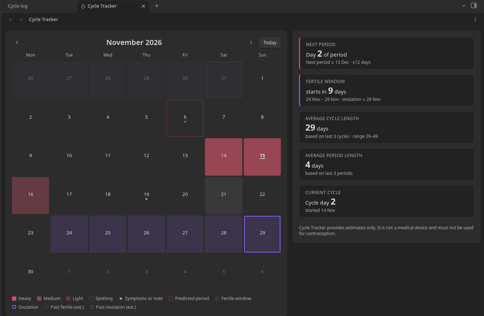
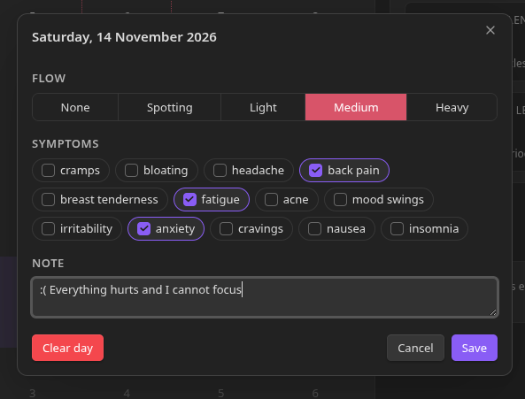

# Cycle Tracker

A private, local-first menstrual cycle tracker for [Obsidian](https://obsidian.md).

Click a day on the calendar to log flow, symptoms and a note. Cycle Tracker predicts your next period and fertile window, and shows your averages on a small dashboard. Everything is stored in **one Markdown file in your vault**. No accounts, no cloud, no network requests.

> **Cycle Tracker provides estimates only. It is not a medical device and must not be used for contraception.**



## Features

- **Calendar:** month view with your logged flow (heavy / medium / light, plus spotting), symptoms and notes. It also shows predicted periods, the fertile window and ovulation.
- **Past estimates:** estimated fertile windows and ovulation days for cycles you have already completed, drawn fainter than predictions.
- **Dashboard:**
  - days until your next period (or how late it is, or which day of your period you are on);
  - the next fertile window;
  - average cycle and period length;
  - current cycle day.
- **Confidence labels:** predictions are marked *low confidence* until you have logged at least 3 cycles.
- **Plain-text data:** you can read and edit the log file by hand, and the view updates automatically.
- **Desktop and mobile:** the layout adapts to the pane width, and both light and dark themes are supported.

## Getting started

1. Open Cycle Tracker from the ribbon (droplet icon), or run **Cycle Tracker: Open calendar and dashboard** from the command palette (`Ctrl/Cmd+P`).
2. Click a day and choose a flow, any symptoms and an optional note. Then press **Save** or **Enter**.
3. Predictions appear once you have logged your first period, and they get better with every cycle.

### Commands

| Command | What it does |
|---|---|
| **Open calendar and dashboard** | Opens the Cycle Tracker tab (or switches to it). |
| **Log today** | Opens the day editor for today. |
| **Open cycle log file** | Opens the Markdown file that stores your data (creates it if needed). |

### The day editor



- **Flow:** None · Spotting · Light · Medium · Heavy.
- **Symptoms:** pick from your list (edit it in settings). Symptoms that are no longer in your list stay on old entries and show in *italics*.
- **Note:** free text. **Shift+Enter** adds a new line.
- **Enter** saves, **Esc** cancels, and **Clear day** deletes the day's entry.

### Reading the calendar

| Mark | Meaning |
|---|---|
| Solid fill (stronger = heavier) | Logged flow |
| Dotted border + small dot | Logged spotting |
| Small grey dot | Symptoms or a note logged |
| Dashed outline | Predicted period |
| Light accent fill | Predicted fertile window |
| Accent ring | Predicted ovulation |
| Fainter fill / dashed ring | Estimated fertile window / ovulation of a past cycle |
| Bold, underlined number | Today |

Hover over a day (or use a screen reader) to see everything logged and predicted for it.

## How predictions work

1. **Periods.** Light, medium and heavy days are grouped into periods. Up to 1 day without flow is allowed inside a period (configurable). **Spotting is shown but does not start or extend a period.**
2. **Cycles.** A cycle runs from the first day of one period to the first day of the next. Cycles shorter than 15 or longer than 90 days are treated as unusual and left out of the averages.
3. **Averages.** The average cycle and period lengths are the **median** of your last 6 cycles and completed periods. A median barely moves when there is one odd cycle.
4. **Next period:** last period start + average cycle length. The *± days* range is based on how much your cycles vary.
5. **Ovulation:** next period start − **12 days** (the luteal phase, configurable).
6. **Fertile window:** the 5 days before ovulation plus ovulation day.

Before your first full cycle, predictions use the default cycle length from settings (28 days).

### Why ovulation is counted backwards

Ovulation does **not** reliably happen on "day 14". In a study of more than 600,000 app-tracked cycles, the average cycle was 29.3 days long. The phase before ovulation varied a lot (about 10–30 days). The phase after it (the luteal phase) was much more stable, averaging about 12.4 days. Only 13% of cycles were exactly 28 days long (Bull et al., 2019). So Cycle Tracker estimates ovulation **backwards from the next period** rather than forwards from the last one.

The fertile window is the six days ending on ovulation day, which is when conception is possible (Wilcox et al., 1995).

Predictions from a calendar alone are always imprecise. Your body does not follow an average, and stress, illness, travel, hormonal contraception, breastfeeding and many other things change cycles. Tracking body signals such as basal body temperature or LH tests gives better estimates. That is planned for a future version.

## Privacy

- **All data stays in your vault**, in a plain Markdown file (default: `Cycle Tracker/Cycle log.md`).
- **No network requests.** There are no analytics, no telemetry, and no external fonts or assets.
- **The log file is synced if your vault is synced.** If you use Obsidian Sync, iCloud, Dropbox, OneDrive, Git or anything similar, the log file is copied there like any other note. To keep it on one device only, exclude its folder from sync:
  - **Obsidian Sync:** Settings → Sync → **Excluded folders** → add `Cycle Tracker`.
  - **Other services:** see their documentation for excluding a folder.
- The file is readable by anyone who can open your vault. Keep this in mind for shared vaults and shared devices.

## The log file

The data lives in the file's frontmatter (YAML) and is easy to read or edit by hand:

```yaml
---
cycle-log-version: 1
entries:
  - date: "2026-11-02"
    flow: heavy
    symptoms: [cramps, fatigue]
  - date: "2026-11-03"
    flow: medium
    symptoms: [cramps]
    note: "Tired today"
  - date: "2026-11-04"
    flow: light
---
```

| Field | Values |
|---|---|
| `date` | `"YYYY-MM-DD"` (keep the quotes) |
| `flow` | `spotting`, `light`, `medium` or `heavy`. Leave it out for no flow. |
| `symptoms` | List of lower-case symptom names |
| `note` | Free text |

Tips for editing by hand:

- **Indent with spaces, never tabs.** YAML does not allow tabs. If your editor inserts them, turn off tab indentation in Obsidian's **Settings → Editor**.
- If the file cannot be read, Cycle Tracker shows what is wrong and **refuses to save until it is fixed**, so it never overwrites your data.
- Entries that do not make sense (for example an invalid date) are skipped, with a warning in the developer console.
- Extra fields you add yourself are kept.
- Moving or renaming the file inside Obsidian is fine: the plugin follows it. If you move it outside Obsidian, update the path in settings.

## Settings

| Setting | Default | Notes |
|---|---|---|
| Log file path | `Cycle Tracker/Cycle log.md` | Created on first save. |
| First day of week | Monday | Monday or Sunday. |
| Future cycles to project | 3 | How many upcoming cycles to draw on the calendar. |
| Show fertile window | On | Fertile window and ovulation on the calendar and dashboard. |
| Show past estimates | On | Fertile windows and ovulation days of past cycles, drawn fainter. |
| Flow colour | `hsl(350 60% 55%)` | Any CSS colour. |
| Default cycle length | 28 | Used until you have logged a full cycle. |
| Default period length | 5 | Used until you have logged a completed period. |
| Luteal phase length | 12 | Days from ovulation to the next period. |
| Max gap between flow days | 1 | Flow-free days allowed inside one period. |
| Cycles used for averages | 6 | Averages use the last N cycles. |
| Outlier cycle bounds | 15 / 90 | Cycles outside this range are left out of averages. |
| Symptom list | cramps, bloating, headache, … | Comma- or line-separated. Renaming a symptom does not change past entries. |

## Installation

Cycle Tracker is not in the community plugin directory yet. To install it manually:

1. Build it (see below) or download `main.js`, `manifest.json` and `styles.css` from a release.
2. Copy the three files to `<your vault>/.obsidian/plugins/cycle-tracker/`.
3. In Obsidian, go to **Settings → Community plugins**, click reload, and enable **Cycle Tracker**.

## Development

Requires Node.js 20 or newer.

```bash
npm install
npm run dev     # watch build -> main.js
npm run build   # type-check + production build
npm run lint    # ESLint with Obsidian's plugin rules
npm test        # unit tests for src/core (Vitest)
```

For a live setup, symlink this folder into a test vault as `.obsidian/plugins/cycle-tracker`. Run `npm run dev`, then use **Reload app without saving** in Obsidian after changes.

### Project layout

```
src/
  main.ts            plugin lifecycle, commands, ribbon, view registration
  settings.ts        settings, defaults, settings tab
  data/LogStore.ts   reads/writes the log file, watches it for changes
  core/              pure logic, no Obsidian imports (enforced by lint), unit-tested
    types.ts         Entry, Period, Cycle, Stats, Prediction, ...
    dates.ts         ISO date helpers (UTC day numbers: no time-zone or DST bugs)
    entries.ts       tolerant parsing and editing of the entries list
    yaml.ts          writes the entries block (always-quoted dates)
    periods.ts       flow days -> periods -> cycles
    predict.ts       statistics and predictions
    calendar.ts      month grid and which days get prediction marks
  view/              CycleView (layout), Calendar, Dashboard
  modal/DayModal.ts  the day editor
tests/               Vitest unit tests for src/core
```

### Manual test checklist

- Log a day: the calendar and dashboard update without reopening the view.
- Edit the log file by hand: the view updates.
- Delete the log file: the view shows the empty state, and logging again recreates the file.
- Narrow the pane, or open it on mobile: the panels stack.
- Light and dark themes are both readable.

## Roadmap

- Basal body temperature and LH test logging (fields are already reserved in the file format). These would confirm ovulation and give a personal luteal phase length.
- A cycle history view with lengths over time.
- Optional mirroring to daily notes.
- CSV export.

## References

- Bull JR, Rowland SP, Berglund Scherwitzl E, Scherwitzl R, Gemzell Danielsson K, Harper J. Real-world menstrual cycle characteristics of more than 600,000 menstrual cycles. *npj Digital Medicine*. 2019;2:83. <https://doi.org/10.1038/s41746-019-0152-7>
- Wilcox AJ, Weinberg CR, Baird DD. Timing of sexual intercourse in relation to ovulation: effects on the probability of conception, survival of the pregnancy, and sex of the baby. *N Engl J Med*. 1995;333(23):1517–1521. <https://doi.org/10.1056/NEJM199512073332301>

## License

[MIT](LICENSE) © 2026 Hermes34-dev

## Disclaimer

Cycle Tracker provides estimates only. It is not a medical device and must not be used for contraception. If you have questions about your cycle or your health, please talk to a doctor or another qualified health professional.
